# Starryblu 申卡教程

---

## 第一阶段：注册账号，等待审批

### Step 1 — 下载 App 并注册

前往 App Store 搜索 **Starryblu** 下载安装。打开后点击注册，**中国手机号即可注册**，输入验证码完成验证。

---

### Step 2 — 证件信息

注册后进入开户流程，**Step 2** 为证件信息页面：

- 签发国选择 **China**
- 证件类型选择 **Passport（护照）**
- 上传护照照片页，确保清晰完整

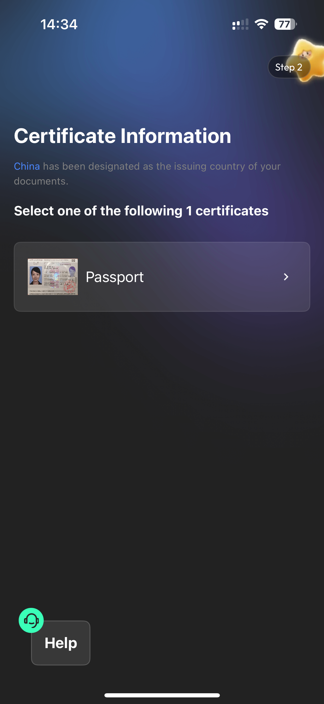

---

### Step 3 — 身份认证

填写个人信息（按护照英文填写）：

- Last Name / First Name（姓 / 名）
- Gender（性别）
- Date of Birth（出生日期）
- Nationality → **China**
- Country/Region of Birth → **China**
- Occupation（职业，如实填写）

填完点击 **Continue**。

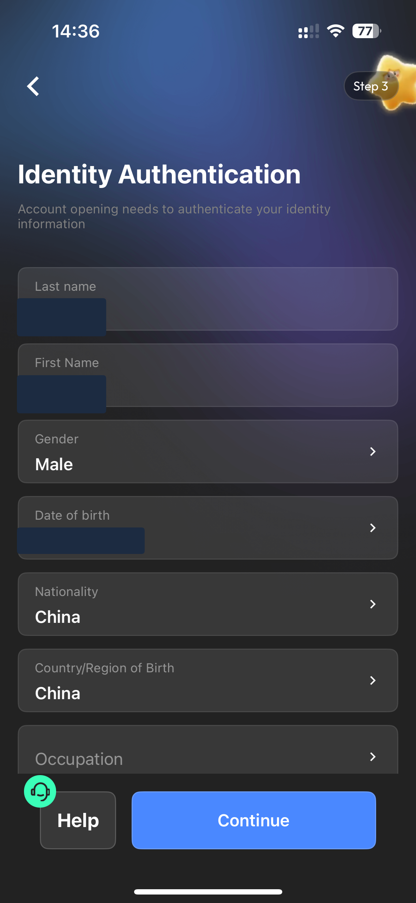

---

### Step 3.5 — 上传地址证明

系统会要求上传 **Proof of Address（地址证明）**：

- 接受国内银行账单、信用卡账单等
- 文件须为近 3 个月内有效
- 推荐使用中国银行等银行的信用卡账单（电子版即可）
- 也可选择 **Utility Bill（水电煤账单）**

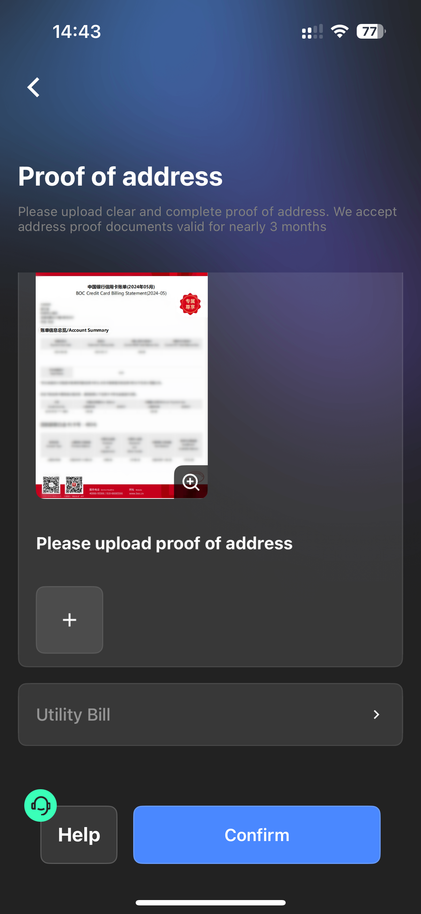

---

### Step 4 — 填写居住地址

上传完成后填写国内地址：

- Province（省）
- City（市）
- District / Street（区 / 街道）
- Detailed Address（详细地址）
- Postal Code（邮政编码）

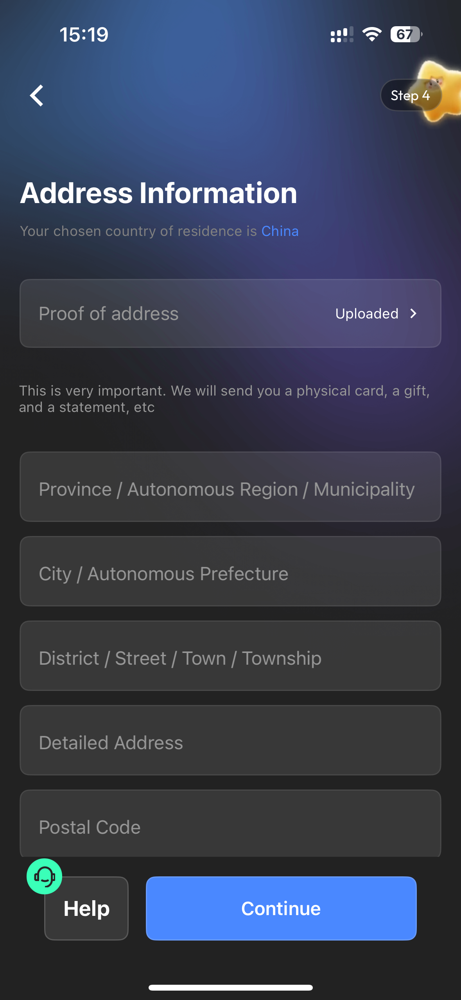

---

### Step 5 — PEP 信息确认

页面提示确认是否为**政治敏感人士（PEP）**，普通用户点击 **Additional information** 按提示选 **No** 即可，约 1-2 分钟完成。

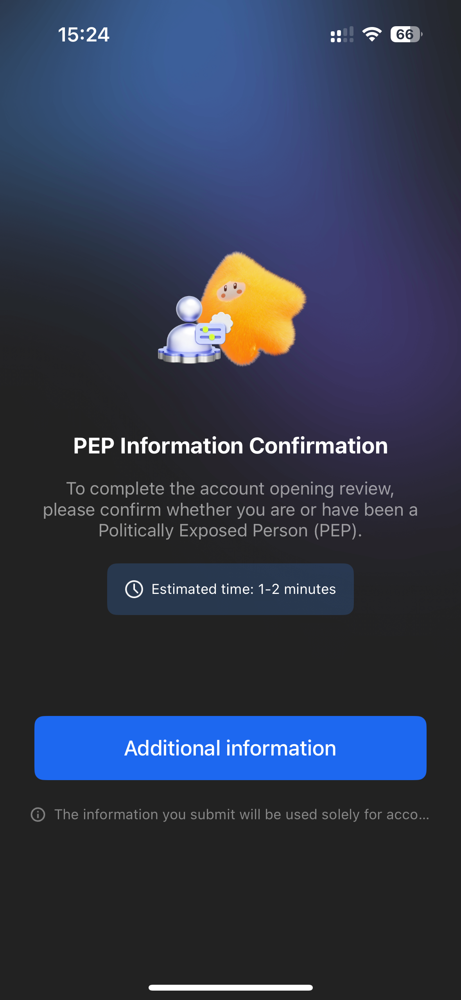

---

### Step 6 — 提交等待审核

全部填写完成后提交，进入审核状态：

> "Our team is reviewing your account information, the account will be opened shortly. Once approved, we will notify you via SMS."

审核通过后会发送短信通知，**最快当天完成**，请耐心等候。

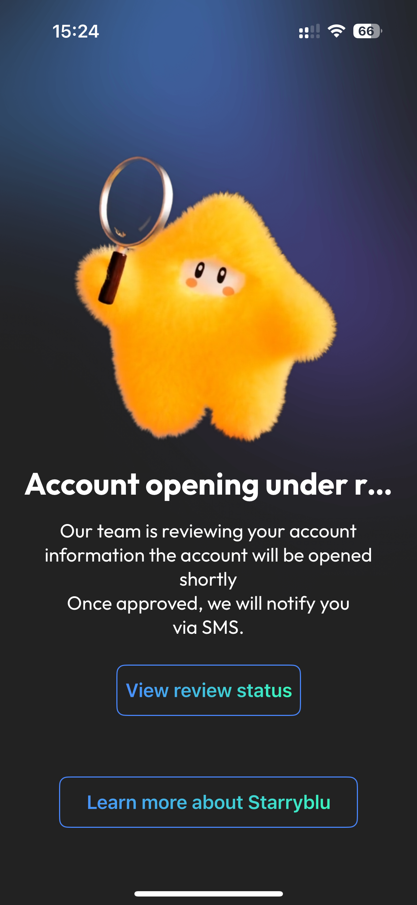

---

## 第二阶段：申请万事达卡

### Step 7 — 进入申卡页面

账号审核通过后，进入 App 的卡片申请页面，页面显示：

> "Debit card and membership services will be online soon — You have not reserved a card yet."

此时直接点击 **Reserve Now** 加入排队，系统会分配一个排队号（如 #73xx）。

> 注意：此入口为排队等候，**免费名额已满**，直接等待无法申卡。

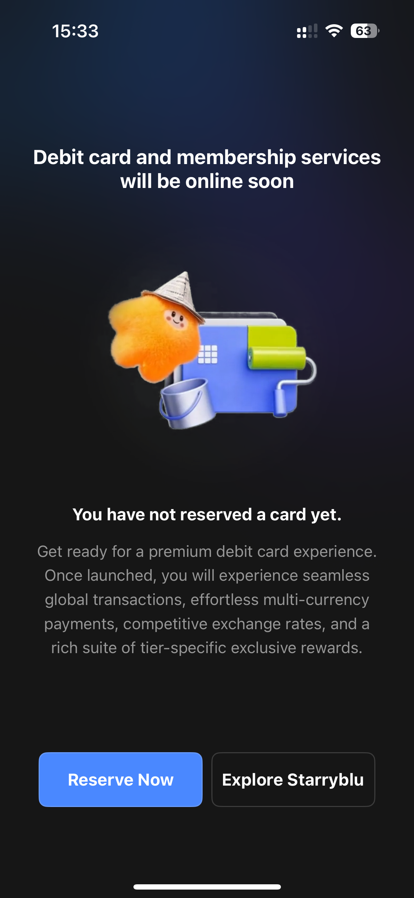
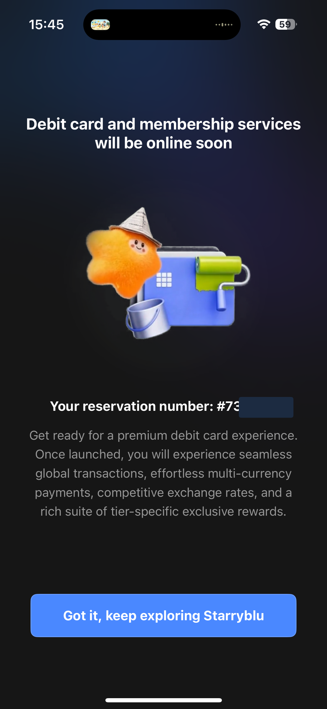

---

### Step 8 — 联系客服开通申请入口

> **注意：此步骤需切换至新加坡 IP，否则客服可能无法为你开通权限。**

需要主动联系客服，协调提前开通申卡权限：

1. 点击 App 内 **Help** 按钮，进入客服页面（Starabo）
2. 发送「**开通 9.9 美元套餐**」给客服
3. 连接人工客服（Live Agent），排队等待接入，告知需要开通申卡入口

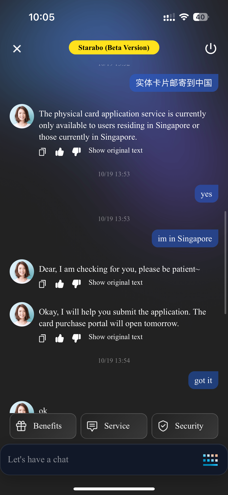

---

### Step 9 — 开通会员，申请虚拟卡

客服协助开通入口后，进入会员升级页面：

| 套餐 | 价格 |
|------|------|
| 月付 | $9.90 / 月 |
| 年付 | $99.90 / 年 |

**推荐选择月付 $9.90**，开通后即可申请虚拟卡，正常用于绑定 ChatGPT、Claude 等 AI 订阅及海外支付。

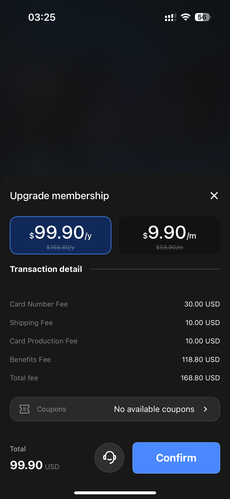

---

## 关于实体卡（不推荐）

实体卡费用较高，月付套餐下实体卡总费用为：

| 费用项 | 金额 |
|--------|------|
| 卡号费 | $30.00 |
| 运费 | $10.00 |
| 制卡费 | $10.00 |
| 会员费 | $9.90 |
| **合计** | **$59.90** |

此外，平台目前实体卡仅对在新加坡居住或当前在新加坡的用户开放，邮寄内地存在限制，**建议申请虚拟卡使用**，性价比更高。

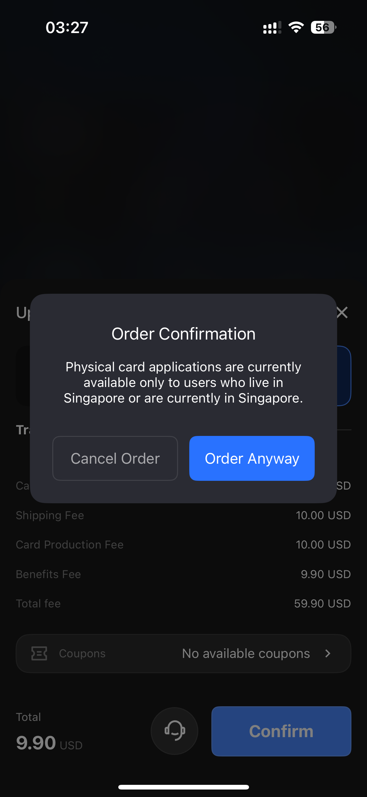

---

> 入金 / 充值需自行解决，教程不含代充服务。实际可用性以开户资格、入金条件及商户受理为准。
